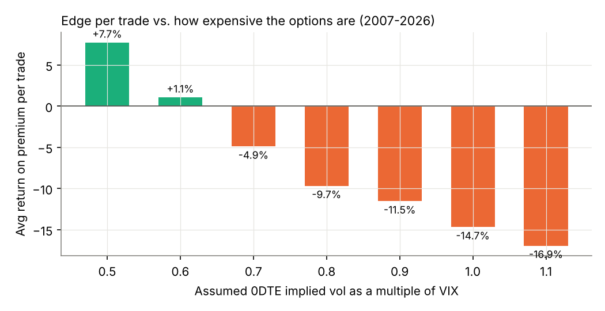
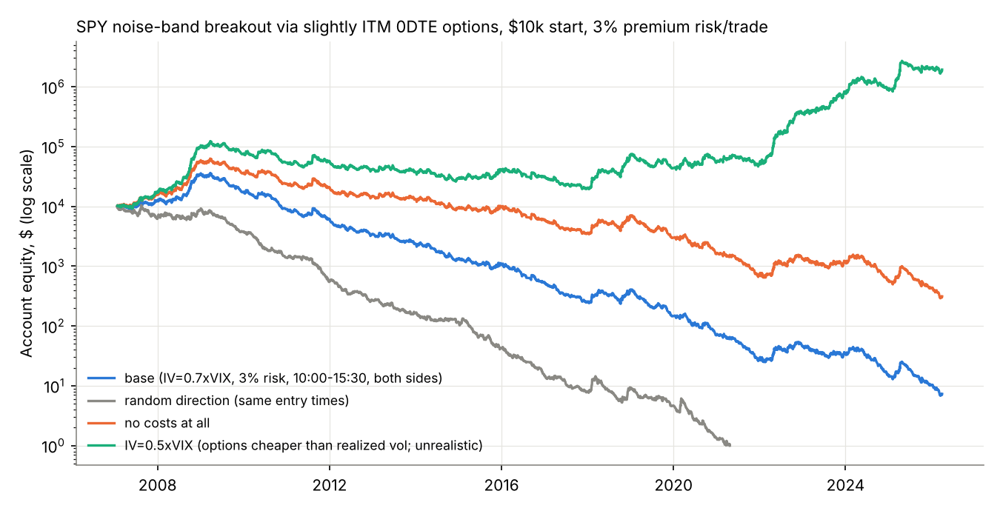

# 0DTE SPY breakout bot: a rebuild and backtest

This rebuilds and backtests the strategy from Finančník.cz, *"Sdílený opční bot pro malé účty: přes 50 % za posledních 12 měsíců"* (r2048), on SPY 1-minute data from 2007-01 to 2026-03 (4,804 sessions, 3,459 signals).

## Verdict

Whether the strategy makes money comes down to one number the backtest can't observe: **the price of 0DTE options on breakout days**.

| Option price (IV as a multiple of VIX) | Typical premium for a slightly ITM contract | Author's live window, 2024-05-17 → 2026-03, 1 contract/signal, $10k account | Full history 2007 → 2026, $300 risk/trade |
|---|---|---|---|
| 0.5 × | **$150–215, the author's stated "$150–200"** | **+57 % to +67 %** (author reports ~+70 % by 2026-07) | +$69k, t = 4.3, but 9 losing years and **~10 years under water (2008 → 2018)** |
| 0.6 × (≈ the volatility SPY actually delivered) | $177–236 | -6 % to -23 % | +$1k: breakeven, t = 0.65 |
| 0.7 × | $200–261 | -82 % to -104 % (account wiped out) | -$60k |

* **At the option prices the article itself quotes, the rebuild reproduces the author's live record.** That cross-checks both the rebuild and the claim: about +66 % over the same period, against the author's ~+70 %.
* **The edge is thin and depends on the regime.** It comes from the options being priced *below* the volatility that followed on breakout days. On signal days, realized vol from entry to close averaged 0.59 × VIX, and breakeven sits at about 0.6 × VIX. Ten points of IV is the difference between +66 % and -11 %.
* **Over the long history, profits cluster in a few trending, volatile years** (2008, 2018, 2022, 2023, 2025). In between came a decade-long flat-to-down stretch. The last 2.5 years of live trading fell in one of the good regimes, which the backtest shows are not the norm.

## 1. The rules, and how they match the article

| Element | Article text (r2048) and the author's related posts | Backtest |
|---|---|---|
| Signal | *"intradenní breakouty volatility"*. Earlier posts say it is built on Zarattini, Aziz & Barbon, *Beat the Market: An Effective Intraday Momentum Strategy for SPY* | The paper's "noise area": `UB = max(Open, PrevClose)·(1+σ_m)`, `LB = min(Open, PrevClose)·(1−σ_m)`. Here `σ_m` is the 14-day mean of `|Close_m/Open − 1|` at the same minute |
| Trigger | 1-minute **close** beyond the level (r2046) | The first 1-min close outside the band, 10:00–15:30, once per day |
| Direction | *"obchoduje long i short"*: buys a call or a put | Call above UB, put below LB |
| Underlyings | *"opce na SPY a QQQ"* | **SPY only.** No long QQQ 1-minute history was reachable from here |
| Strike | Slightly ITM. *"know-how … jaká je strike cena"*, details not public | Strike ≥ $0.50 ITM (average depth $1). Also tested $0–1 and $1–2 |
| Price | *"150 až 200 dolarů"* per contract | Used to **calibrate** the IV (section 3) |
| Entry and exit orders | v2.0 uses **limit orders** on entry and exit | Next bar's open; $0.02/share slippage each way; $0.65/contract commission |
| Stop | *"Pozice neřídí stop-lossem"* | None |
| Exit | *"výstup je naplánovaný na závěr seance, případně může bezcenná opce vypršet"* | 15:58 bar close; a worthless option expires with no exit commission |
| Size | 1 contract ≈ 3–4 % of a $5k account; $10k covers SPY + QQQ | 1 contract per signal, plus 3 %-of-equity and fixed-$300 variants |

The author also says they trade *"v drobné modifikaci"* (a small modification) and that the exact strike rule is part of the know-how. So this tests the published logic, not the bot's exact code.

## 2. About "survivorship bias" for this strategy

The strategy trades options on **the index ETF itself** (SPY/QQQ), not a basket of stocks picked from the index. The SPY price series already contains every company that was in the S&P 500 on each historical day, including the ones later dropped, bankrupt or acquired. Survivorship bias only appears if you rebuild an index from *today's* members. Here the actual tape of the traded instrument is used, so the bias isn't present.

Two related biases do apply:

* **Hindsight choice of market and window.** SPY/QQQ, and a live account that started in May 2024, sit inside one of the strategy's best regimes. The full 2007–2026 test, with 2008, the 2009–2017 sideways-volatility years, 2020 and 2022, is the correction. A **random-direction control** (same entry times, coin-flip side) separates the signal from the option payoff.
* **A single live track record.** About 150 trades a year, with payoffs as skewed as these, give a wide confidence interval for any 12-month figure. "+50 % in 12 months" and "+90 % in 2.5 years" fit the backtest at calibrated prices. They say little about the next 2.5 years.

## 3. Data and the option-price model

* **SPY 1-minute OHLCV**, 2000–2026, unadjusted, ET. Source: the public repo `prsdro/spy`. Filtered to full 09:30–16:00 sessions; real halts are kept, e.g. 2020-03-16.
* **CBOE VIX daily**: that day's open, so there is no look-ahead.
* `data/fetch_data.sh` downloads both files.

No historical 0DTE option quotes were reachable (CBOE DataShop, OptionsDX, Polygon and ThetaData are paid or blocked). Option prices are therefore **modelled with Black-Scholes, IV = `iv_mult × VIX_open`**, in trading-time units. Daily SPY expirations exist only since 2022-11-14, so earlier years show "what this payoff would have done".

Calibration (`calibrate.py`):

* **Realized volatility on signal days**, entry → close, from 1-min returns: mean **0.59 × VIX**, median 0.54, RMS 0.63. VIX also prices overnight and weekend risk, which is why intraday vol is well below it.
* **The author's stated $150–200** premium matches **IV ≈ 0.4–0.6 × VIX**, depending on strike depth. The central case is **0.5 × VIX**, at a $1-ITM strike with a $181 median premium.
* A real 0DTE option prices in a breakout as soon as it happens: IV rises on the move, and the ask is paid. A VIX-at-the-open model ignores that, so it **flatters a breakout buyer**. The author's real fills are the best evidence available that the cheap end is real.

## 4. Author's live window, 1 contract per signal, $10k account

Start dates: 2024-05-17 (from r2046, matching "about 2.5 years" in r2048) and 2025-04-01. The data ends on 2026-03-31, so the article's exact "last 12 months", roughly autumn 2025 to autumn 2026, is only partly covered.

| Strike rule (avg ITM) | IV/VIX | Median premium | From 2024-05-17 | Max DD | From 2025-04-01 | Max DD |
|---|---|---|---|---|---|---|
| $0–1 ITM ($0.48) | 0.5 | $151 | **+57 %** | -24 % | +40 % | -20 % |
| $0.5–1.5 ITM ($0.98) | 0.5 | $181 | **+66 %** | -24 % | **+47 %** | -16 % |
| $1–2 ITM ($1.48) | 0.5 | $215 | +67 % | -25 % | +48 % | -16 % |
| $0.5–1.5 ITM | 0.4 | $159 | +142 % | -11 % | +93 % | -8 % |
| $0.5–1.5 ITM | 0.6 | $204 | -11 % | -48 % | +1 % | -41 % |
| $0.5–1.5 ITM | 0.7 | $229 | -90 % | -98 % | -46 % | -69 % |

## 5. Full history, 2007 → 2026

### Edge per trade against the option price



| IV / VIX | Return on premium per trade | Win rate | Profit factor | CAGR at 3 % risk, compounding | Max DD |
|---|---|---|---|---|---|
| 0.5 (calibrated to the article) | **+7.7 %** | 45 % | 1.18 | +31.6 % | **-84 %** |
| 0.6 (≈ realized) | +1.1 % | 43 % | 0.98 | -6.6 % | -98 % |
| 0.7 | -4.9 % | 42 % | 0.94 | -31 % | -100 % |
| 1.0 (priced at VIX) | -14.7 % | 37 % | 0.76 | -59 % | -100 % |



### Year by year, fixed $300 risk per trade (as in the author's own backtests)

| Year | P&L at 0.5 × VIX | per trade | P&L at 0.6 × VIX | per trade |
|---|---|---|---|---|
| 2007 | +5,954 | +12.6 % | +4,313 | +9.4 % |
| 2008 | **+19,036** | +34.7 % | +15,043 | +27.6 % |
| 2009 | -2,207 | -3.0 % | -4,243 | -6.8 % |
| 2010 | -3,041 | -4.4 % | -4,619 | -7.5 % |
| 2011 | +1,228 | +3.3 % | -973 | -0.6 % |
| 2012 | -2,808 | -4.1 % | -4,105 | -6.6 % |
| 2013 | -737 | -0.1 % | -2,029 | -2.5 % |
| 2014 | -1,695 | -1.8 % | -3,335 | -4.7 % |
| 2015 | +3,858 | +8.0 % | +1,159 | +3.2 % |
| 2016 | -1,993 | -2.6 % | -4,337 | -7.1 % |
| 2017 | -4,326 | -7.2 % | -5,784 | -10.0 % |
| 2018 | **+13,962** | +25.7 % | +9,486 | +17.7 % |
| 2019 | -3,876 | -6.9 % | -6,570 | -12.4 % |
| 2020 | +3,156 | +6.9 % | -2,225 | -3.7 % |
| 2021 | +373 | +1.5 % | -4,581 | -8.7 % |
| 2022 | **+21,433** | +40.1 % | +13,084 | +24.6 % |
| 2023 | +9,350 | +17.1 % | +3,263 | +6.4 % |
| 2024 | +2,034 | +4.5 % | -3,395 | -5.6 % |
| 2025 | **+10,284** | +21.6 % | +3,202 | +7.0 % |
| 2026 Q1 | -594 | -4.0 % | -2,174 | -16.1 % |
| **Total** | **+$69,392**; 9 losing years; worst DD -$14.1k; 3,563 days under water | t = 4.3 | **+$1,180**; 13 losing years | t = 0.65 |

### Robustness at IV = 0.7 × VIX

These tests use the pessimistic pricing. They compare variants of the rules, so the level doesn't matter.

| Variant | Return on premium per trade |
|---|---|
| Base | -4.9 % |
| **Random direction, same entry times** | **-10.0 %** (the signal adds about 5 points per trade) |
| Long calls only | -5.6 % |
| Require a fresh cross | -5.7 % |
| Signals from 09:31 | -5.1 % |
| Band × 1.5 | -2.8 % |
| $2 ITM | -0.5 % |
| Slippage $0.05/share | -9.6 % (execution quality matters, hence the v2.0 limit orders) |
| Zero costs | -2.1 % |
| Paper's VWAP/band trailing exit instead of holding | -1.5 % |

## 6. Is the signal itself real? (the paper replicated on the ETF)

The paper's original rules, traded on the SPY ETF at 1× notional: checks every 30 minutes, a VWAP/band trailing stop, flat at the close. Results: **Sharpe 1.24 gross** (CAGR 9.6 %, max DD -11.6 %) and Sharpe 0.60 net of 1 bp per side. That is close to the paper's ≈1.3, so the signal code is right. The author's options variant gives up the trailing stop and holds to the close. Measured on the underlying, that version earns +2.3 bp/trade (t = 1.55). The option version makes money mainly through **convexity on the big trend days**, not through a high hit rate.

## 7. What would settle it

* **Real 0DTE SPY/QQQ quotes**, from 2022-11 onwards (CBOE DataShop, OptionsDX, Polygon/Massive, ThetaData). Only the two `bs(...)` pricing lines in `run()` need replacing with the quoted ask at entry and bid at exit. This removes the IV assumption that decides everything above.
* **The author's IBKR trade log**, which would give the real premium paid, strike depth and fill times. Fitting `iv_mult` and `itm` to it would make sections 4–5 a real out-of-sample check from 2007.
* **QQQ 1-minute data.** The code is ticker-agnostic. The author runs both, and two partly correlated streams would cut the drawdowns somewhat.

## Reproduce

```bash
pip install pandas numpy scipy matplotlib
./data/fetch_data.sh
python3 backtest.py --set iv_mult=0.5 risk_mode=contracts risk=1.0   # single run -> stats + results/trades.csv
python3 analysis.py      # IV sweep, variants, controls, paper replication, charts
python3 calibrate.py     # realized/VIX, author-window grid, calibrated full history
```

Sources: [article r2048](https://www.financnik.cz/clanky/praxe/sdileny-opcni-bot-pro-male-ucty-pres-50-za-poslednich-12-mesicu-r2048), [r1995](https://www.financnik.cz/clanky/praxe/day-trading-breakoutu-s-0tde-opcemi---extra-paka-s-limitovanym-riskem-r1995), [r1996](https://www.financnik.cz/clanky/praxe/shortovani-breakoutu-skrz-0tde-opce---316-zisk-na-obchod-r1996), [r1999](https://www.financnik.cz/clanky/praxe/obchodovani-intradennich-breakoutu---etf-vs-opce-vs-e-mini-futures-r1999/), [r2046](https://www.financnik.cz/clanky/praxe/zhodnoceni-pres-70-na-malem-uctu-s-0dte-opcemi-zkusenosti-z-automatickeho-obchodovani-r2046). Zarattini, Aziz & Barbon (2024), SSRN 4824172.
